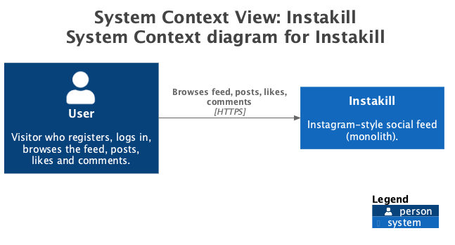
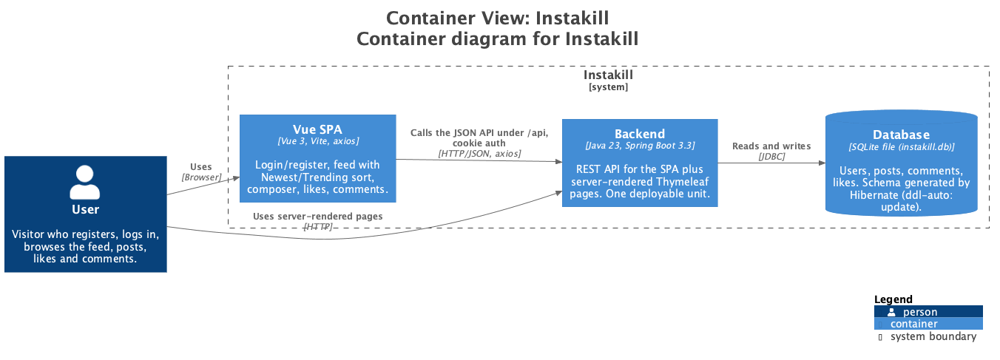
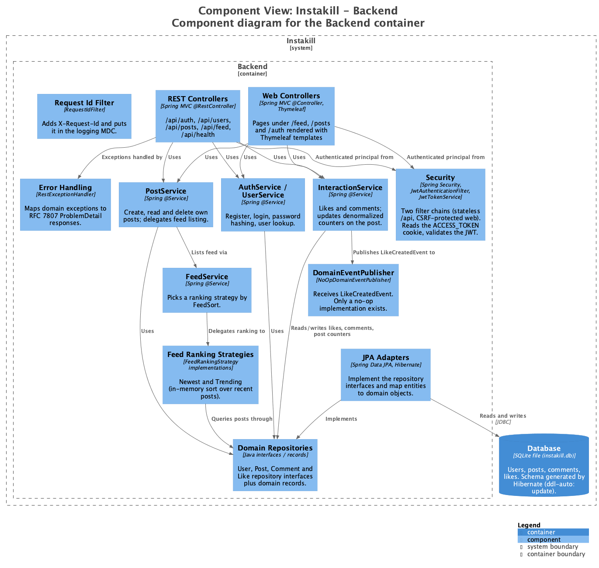

# Week 2 – Quality Attribute Assessment

Instakill today is a single Spring Boot process that serves both a REST API (for the Vue SPA) and server-rendered Thymeleaf pages, backed by one SQLite file. Diagrams: [context](context.png), [container](container.png), [component](component.png) (source: [workspace.dsl](workspace.dsl)).

## Ratings

| Attribute | Rating (1–10) | Justification |
|---|---|---|
| Performance | 5 | Queries are paged and the hot columns are indexed (`created_at`, `post_id`, `author_id`). But the feed does one user lookup and one "liked?" lookup per post (N+1), and the Trending strategy fetches a window of recent posts and sorts it in memory. SQLite also allows only one writer at a time. |
| Scalability | 3 | Everything runs in one process on a local SQLite file, so the system can only scale up, not out, and the database cannot be shared by several instances. Stateless JWT authentication is the one thing that would not block running more instances. |
| Reliability | 4 | There is a single point of failure (one process, one DB file) with no replication or backup. Transactions and the central `RestExceptionHandler` give predictable failures, but like/comment counters are recomputed after each write with no locking, so concurrent requests can leave them stale. |
| Maintainability | 8 | Packages follow bounded contexts with domain / application / API layers, and repositories are interfaces implemented by JPA adapters. Strategy (feed ranking) and Null Object (event publisher) make extension cheap, and `Clock` / `IdGenerator` are injectable, which keeps tests simple. The REST and web controllers duplicate the feed-to-DTO logic, and static mappers couple `common` to the API DTOs. |
| Security | 6 | Passwords are hashed with BCrypt, the JWT lives in an HttpOnly `SameSite=Lax` cookie, the web chain has CSRF protection, and the API validates input. Weak points: the JWT secret is committed in `application.yaml`, the cookie is not `Secure`, the token is also returned in the login response body, there is no rate limiting or token revocation, and the generic 500 handler returns `ex.getMessage()` to clients. |
| Usability | 5 | The SPA covers the basic flow (register, log in, post, like, comment, sort the feed) and is simple to understand. It is minimal: no profiles, follow, or delete in the UI, no pagination controls, and two separate UIs (SPA and Thymeleaf) that behave differently. |

## Main gaps

1. **Scalability / reliability:** the SQLite file and in-process design are the ceiling. A server database (e.g. PostgreSQL) is the first step toward scaling out.
2. **Performance:** batch-load authors and "liked" flags for a page of posts; give Trending a real repository query (`findTrending` already exists but is unused).
3. **Security:** move the JWT secret out of the repo, set `Secure` on the cookie in production, and stop echoing internal messages on 500 errors.
4. **Maintainability:** share one feed-to-DTO assembler between the REST and web controllers.
